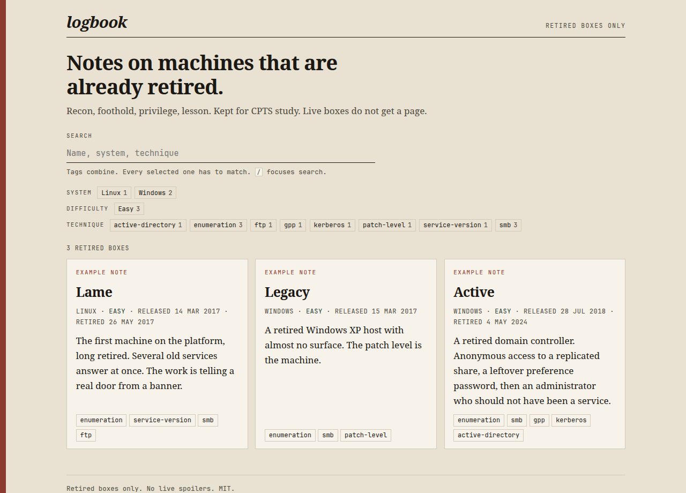

# logbook

[](site/index.html)
[](LICENSE)
[](scripts/build.py)

Methodology notes for retired Hack The Box machines, kept while I work towards CPTS.

One folder per box. Four headings: recon, foothold, privilege, lesson. A single Python script reads the frontmatter and builds a static index, on the grounds that I am not maintaining a table by hand.

Live boxes do not go in here. The three samples are example notes, written so the shelf was not empty, and marked as such on the page. They are original. They name the class of issue and the impact, and they stop there.

Hack The Box is somebody else's trademark. This is a personal shelf. It is not affiliated with them.

<details>
<summary>Add a write-up</summary>

Copy [`templates/writeup.md`](templates/writeup.md) to `boxes/<slug>/writeup.md`.

The folder name is the slug of `name`. `Active` lives in `boxes/active/`. `Box Name` would live in `boxes/box-name/`.

`retired` stays `true`. The build refuses anything else, and on this occasion the build is right. `difficulty` is Easy, Medium, Hard, or Insane. `techniques` are lowercase slugs (`gpp`, `kerberos`, `patch-level`). `summary` is one line, because that line is the card.

Write the four sections. What you looked at, the class of issue, the impact, the sentence you would actually put in a report. Passwords, payloads, and live machines stay out.

Then:

```sh
python3 scripts/build.py
```

Commit the markdown and the regenerated `site/`. `make site` is the same command. `make check` runs the parser fixture first.

</details>

<details>
<summary>What a page looks like</summary>

The index is the shelf. System, difficulty, and technique are all tags. Tags combine: a box has to match every one you press. The count underneath is the honest number.



A card is the frontmatter, and nothing cleverer:

```
Lame · Linux · Easy · retired 26 May 2017
The first machine on the platform, long retired. Several old
services answer at once. The work is telling a real door from a banner.
enumeration · service-version · smb · ftp
```

Open one and the note is the same four headings as the template. Samples carry an "example methodology note" line so they cannot be mistaken for a borrowed walkthrough.

</details>

<details>
<summary>How the generator works</summary>

`scripts/build.py` is stdlib only. No PyYAML, no Markdown library, no occasion to debug a dependency on a Sunday.

```
boxes/<slug>/writeup.md
        |
        v
scripts/build.py
        |
        +-- site/index.html      the shelf, with tag search
        +-- site/index.json      the same facts, for whatever comes next
        +-- site/boxes/<slug>/   one HTML page per note
        +-- site/404.html        for the paths that are not boxes
```

It walks `boxes/*/writeup.md`, checks the frontmatter, and converts a small Markdown subset: headings, paragraphs, lists, tables, quotes, fenced code, links, bold, italic, inline code. Images and nested lists are out on purpose. A table will cope with a sketch.

Tag search lives in `assets/site.js`. It filters the cards in the browser. The query string remembers the selection (`?tag=smb&tag=windows`), and a technique on a write-up links back to the shelf that way. `/` focuses the search box. Escape clears it.

The order on the shelf is release date, then name.

Preview locally with `python3 -m http.server -d site`. That server has its own 404, which is off-brand. GitHub Pages uses `site/404.html`.

[`.github/workflows/pages.yml`](.github/workflows/pages.yml) rebuilds `site/` on every push to `main` and deploys it. In the repository settings, set Pages to GitHub Actions. The site will then be at `https://wastedpatriot.github.io/logbook/`.

</details>

<details>
<summary>Roadmap</summary>

- More retired boxes, once I have actually done them. The samples are scaffolding, not a canon.
- A single page mapping notes to CPTS objectives, when there are enough notes that the map would say something.
- A diagram in a note, if a trust boundary needs drawing. Not before.
- A login page is not on the list. If one appears, something has gone wrong.

</details>

<details>
<summary>Captain's log</summary>

`python3 scripts/build.py --stardate` prints a stardate and then builds the site exactly as usual. `--help` does not mention the flag. The HTML does not change. The same log is closed in the footer of every page, which is where a footer belongs, and the 404 has a shorter entry for people who get lost on purpose.

It will not help with the exam.

</details>

MIT. The terms are in [LICENSE](LICENSE).
